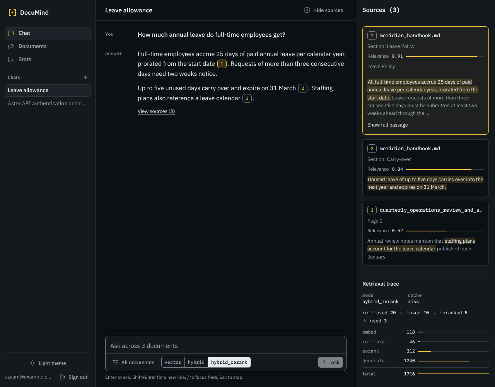
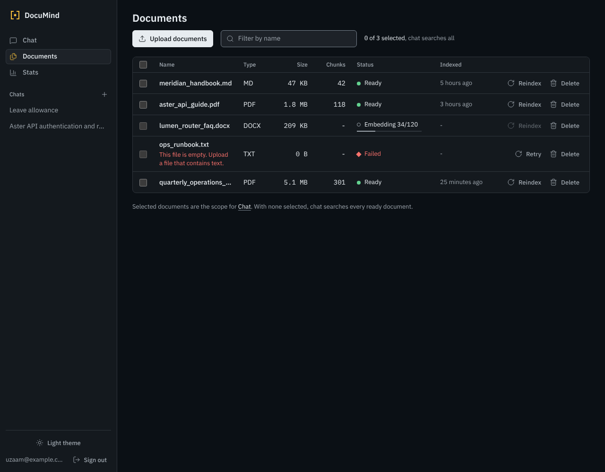
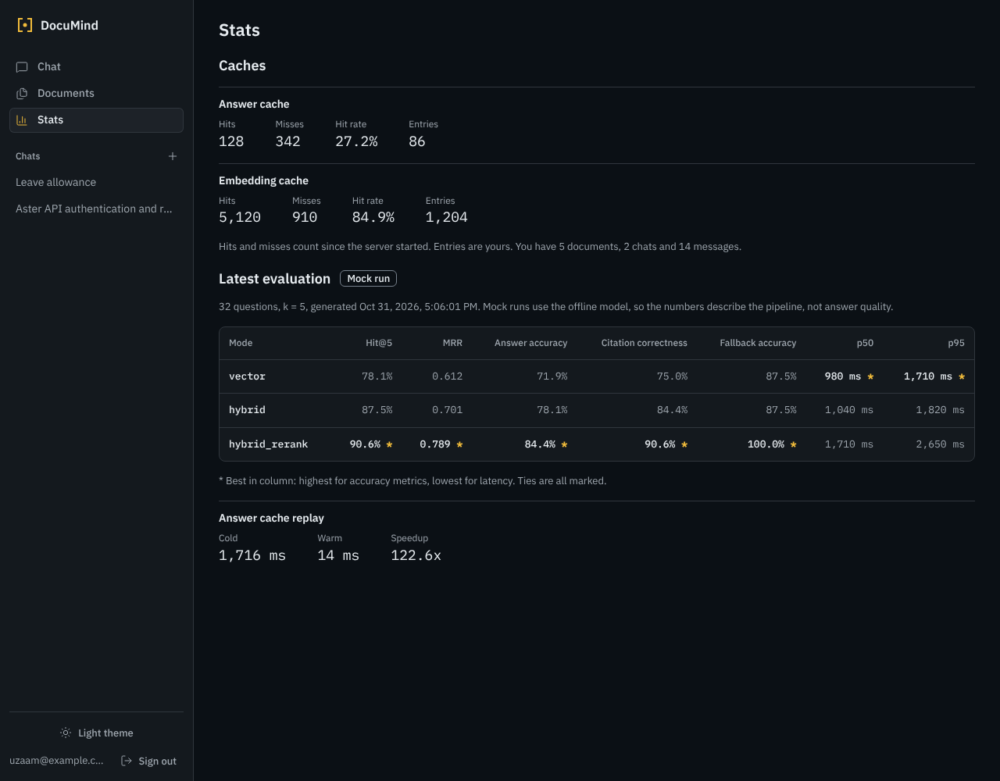
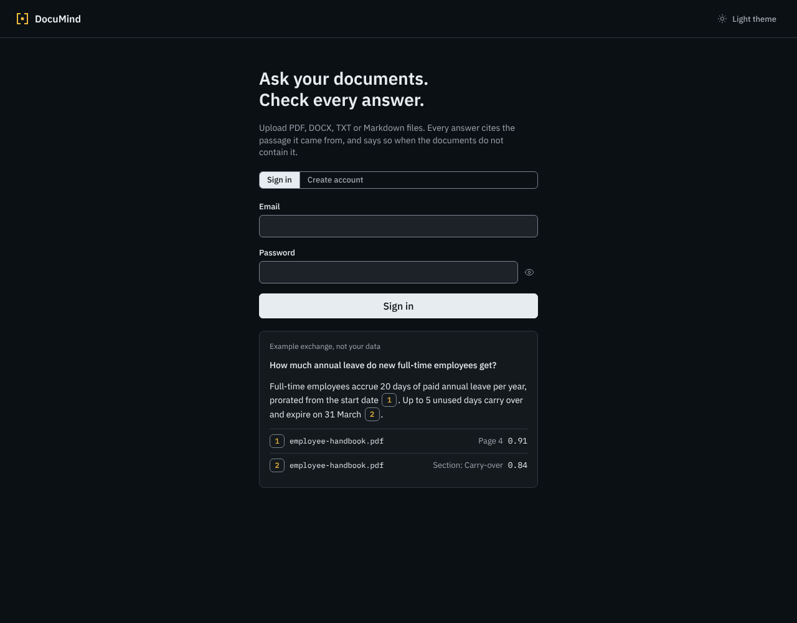
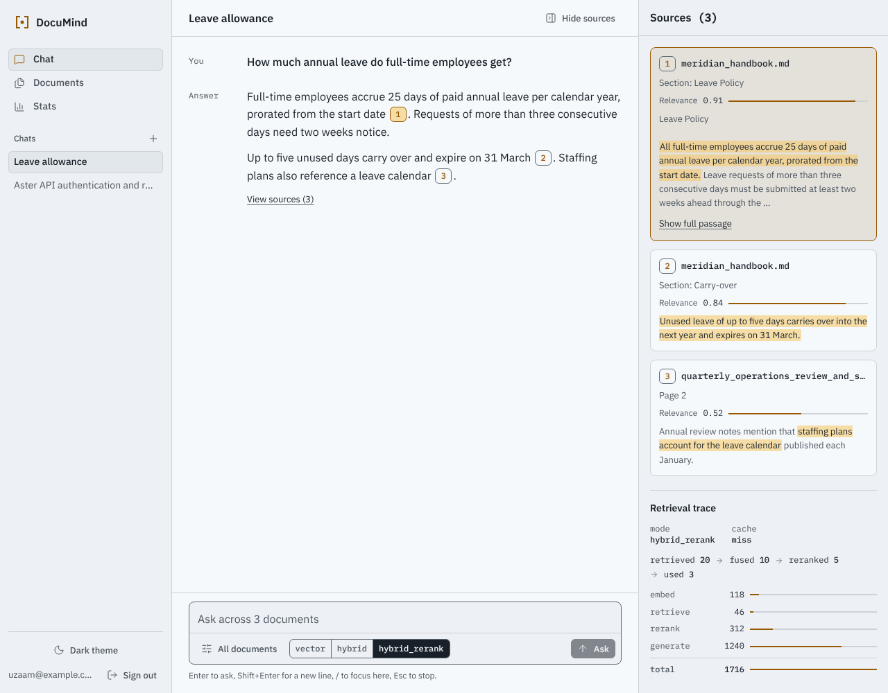
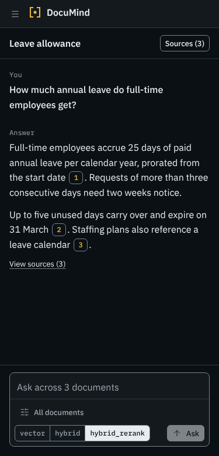
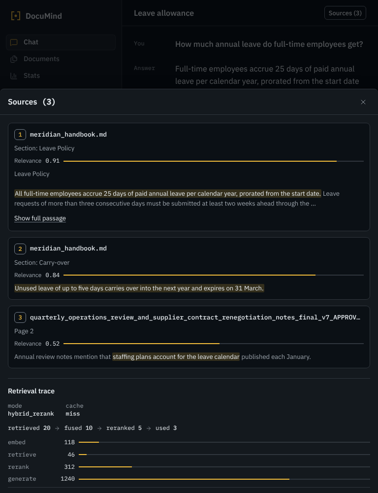
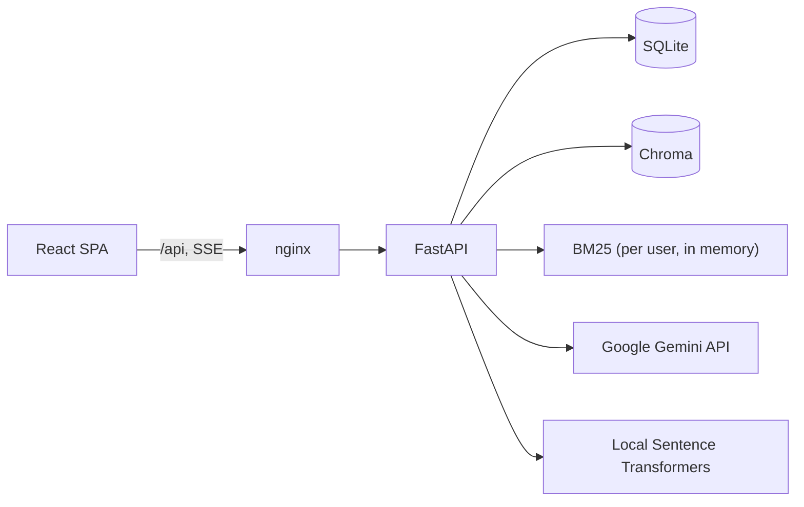

# DocuMind

Upload PDF, DOCX, TXT, Markdown, XLSX, PPTX, HTML and image files (PNG, JPG, WEBP), then ask questions and get **cited answers you can check**. Every answer
shows the exact passages it came from, how they were retrieved, and whether the cache was used. If your documents do
not contain the answer, DocuMind says so instead of guessing.



## Features

- **Ingestion**: drag and drop, multiple files, live stage and progress (`Embedding 34/120`), readable failure reasons
  (empty, corrupt, wrong type, oversize, scanned PDF without text), reindex, delete.
- **Hybrid retrieval**: vector search (Chroma) plus BM25, fused with Reciprocal Rank Fusion, optionally reranked by the
  LLM. Three selectable modes: `vector`, `hybrid`, `hybrid_rerank`.
- **Grounded, cited answers** streamed over Server-Sent Events. Markers like `[1]` open the matching passage with the
  supporting sentence highlighted.
- **No-hallucination fallback**: a score threshold and a model-side `NOT_FOUND` check produce a plain "not found".
- **Retrieval trace** under every answer: funnel counts (`retrieved 20 -> fused 10 -> reranked 5 -> used 3`),
  cache hit or miss, per-stage latency. All values are measured, none are decorative.
- **Chat history and follow-ups**: sessions with rename and delete; follow-up questions are rewritten into standalone
  questions before retrieval.
- **Auth and isolation**: JWT login; every database, vector and BM25 query is filtered by user.
- **Caching**: answer cache (TTL, invalidated by a per-user `index_version`) and embedding cache.
- **Evaluation harness**: 37 questions over four sample documents, compared across the three retrieval modes.
- **Quality**: 92 offline tests, ruff-clean backend, GitHub Actions CI, Docker Compose.

## Screenshots

| | |
|---|---|
|  |  |
|  |  |
|  |  |

## Architecture



Sequence diagrams for ingestion, asking and cache invalidation are in [docs/architecture.md](docs/architecture.md).
The exact API shapes are in [docs/CONTRACT.md](docs/CONTRACT.md).

## Tech stack

| Area | Choice |
|---|---|
| Backend | Python 3.11, FastAPI, Pydantic v2, SQLAlchemy 2, Uvicorn |
| Models | Google Gemini Developer API free tier for chat/reranking; local Sentence Transformers embeddings |
| Vector store | ChromaDB (persistent, cosine) |
| Keyword search | `rank_bm25` |
| Parsing | `pypdf`, `python-docx` |
| Auth | PyJWT, `bcrypt` |
| Frontend | React 18, Vite, plain CSS, IBM Plex (self-hosted), lucide-react, react-router-dom |
| Ops | Docker, docker compose, nginx, GitHub Actions |
| Tests and lint | pytest, pytest-asyncio, httpx, ruff |

## Quick start

### Docker

```bash
cp .env.example .env          # set GEMINI_API_KEY from Google AI Studio
docker compose up --build
```

- App: http://localhost:3000
- API docs (Swagger): http://localhost:8000/docs

Create an account, choose **Load sample documents**, and ask "What are the core hours at Meridian Labs?".

### Local development

```bash
make setup                    # venv + backend deps + npm ci
make dev                      # API on :8000 (mock models), Vite on :5173
```

or by hand:

```bash
python3 -m venv .venv && .venv/bin/pip install -r backend/requirements-dev.txt
cd backend && MOCK_LLM=true ../.venv/bin/uvicorn app.main:app --reload     # API
cd frontend && npm ci && npm run dev                                         # UI
```

Use Gemini by setting `GEMINI_API_KEY` in the repository-root `.env` file. Embeddings run locally and do not call a paid embedding API.

## Configuration

All settings are environment variables (see [.env.example](.env.example)).

| Variable | Default | Purpose |
|---|---|---|
| `GEMINI_API_KEY` | none | Google AI Studio key; required unless `MOCK_LLM=true`. Uses Gemini Developer API free tier subject to Google quotas. |
| `MOCK_LLM` | `false` | Deterministic offline models for tests, CI and demos |
| `JWT_SECRET` | placeholder | Set a long random value before deploying (a warning is logged otherwise) |
| `JWT_EXPIRE_MINUTES` | `60` | Token lifetime |
| `BCRYPT_ROUNDS` | `12` | Password hashing cost |
| `GEMINI_CHAT_MODEL` | `gemini-3.5-flash-lite` | Gemini chat and reranking model. Free-tier access and quotas depend on Google account/project. |
| `LOCAL_EMBEDDING_MODEL` | `sentence-transformers/all-MiniLM-L6-v2` | Local embeddings; no API charges. Re-index after changing this model. |
| `CHUNK_SIZE` / `CHUNK_OVERLAP` | `800` / `150` | Characters per chunk and overlap |
| `TOP_K` | `5` | Chunks passed to the model |
| `RETRIEVAL_MODE` | `hybrid_rerank` | Default mode when a request does not choose one |
| `SCORE_THRESHOLD` | `0.25` real, `0.12` mock | Minimum cosine similarity for `vector` and `hybrid` |
| `RERANK_THRESHOLD` | `0.3` | Minimum rerank score (0..1) for `hybrid_rerank` |
| `MAX_UPLOAD_MB` | `20` | Per-file limit |
| `CACHE_TTL_SECONDS` | `86400` | Answer cache lifetime |
| `CORS_ORIGINS` | localhost dev origins | Comma-separated |
| `DATA_DIR` | `./data` (from `backend/`) | SQLite, Chroma, uploads |
| `EVAL_RESULTS_PATH` / `SAMPLE_DOCS_DIR` | `../eval/...` | Stats page results and bundled samples |

## API overview

Full request and response shapes: [docs/CONTRACT.md](docs/CONTRACT.md), or Swagger at `/docs`.

| Method | Path | Purpose |
|---|---|---|
| GET | `/health` | Liveness, DB and Chroma checks |
| POST | `/api/auth/register`, `/api/auth/login` | Get a JWT |
| GET | `/api/auth/me` | Current user |
| POST / GET | `/api/documents` | Upload (multipart `files`) / list |
| GET / DELETE | `/api/documents/{id}` | Details / delete with chunks and cached answers |
| POST | `/api/documents/{id}/reindex` | Re-run ingestion |
| POST | `/api/documents/sample` | Load the bundled sample documents (idempotent) |
| GET / POST | `/api/sessions` | List / create chats |
| PATCH / DELETE | `/api/sessions/{id}` | Rename / delete |
| GET | `/api/sessions/{id}/messages` | History with citations and trace |
| POST | `/api/sessions/{id}/ask` | Ask, answer streams as SSE: `stage`, `citations`, `token`, `done` or `error` |
| POST | `/api/ask` | Ask without a session, one JSON response |
| GET | `/api/stats` | Cache hit rates and usage |
| GET | `/api/eval/latest` | Latest evaluation results |

Errors always look like `{"error": {"code": "...", "message": "..."}}`.

## Tests

```bash
make test                                   # backend pytest + frontend build
cd backend && ../.venv/bin/python -m pytest -q
```

92 tests run fully offline with `MOCK_LLM=true`: auth, parsing and intake validation, chunking, RRF math, rerank JSON
handling, the RAG fallback and follow-up rewrite, cache hit, miss, TTL and invalidation, zero model calls on a hit,
cross-user isolation, SSE event order and payloads, error envelopes, restart recovery, and the eval harness.

## Evaluation

```bash
python eval/run_eval.py --mock     # offline, deterministic
python eval/run_eval.py            # Gemini API (needs GEMINI_API_KEY; consumes free-tier quota)
```

It indexes four original sample documents (Markdown, a real PDF, DOCX, plain text) into a temporary store and runs 37
questions per retrieval mode: 14 single-fact, 8 paraphrased, 6 multi-hop and 9 unanswerable. It reports Hit@k and MRR
(was the expected page or section retrieved), LLM-judged answer accuracy, citation correctness, fallback accuracy,
latency p50 and p95, and cold versus warm cache latency. Output: `eval/results/report.md` and `results.json`, which the
in-app Stats page displays.

### Results: mock models (committed, reproducible in CI)

> **These numbers come from the deterministic mock models, not OpenAI.** Mock embeddings match words, not meaning, so
> the 8 paraphrased questions mostly fail by design. They prove the pipeline and metrics work; they are not a quality
> claim. Mock latency measures only local code.

| Mode | Hit@5 | MRR | Answer accuracy | Citation correctness | Fallback accuracy | p50 ms | p95 ms |
|---|---|---|---|---|---|---|---|
| `vector` | 78.6% | 0.667 | 53.6% | 60.7% | 67.6% | 13 | 15 |
| `hybrid` | 82.1% | 0.717 | 53.6% | 60.7% | 67.6% | 14 | 18 |
| `hybrid_rerank` | 89.3% | 0.795 | 55.4% | 64.3% | 70.3% | 13 | 15 |

Answer cache: cold 14 ms vs warm 7 ms (2.0x) on 10 repeated questions.

### Results: real Gemini models

_Not run yet. Run `python eval/run_eval.py` with a Gemini key, paste the table from `eval/results/report.md` here, and use
those numbers in your resume bullets._

## Design decisions and trade-offs

- **Hybrid search with RRF.** Embeddings find paraphrases; BM25 finds exact terms such as error codes and names that
  embeddings blur. RRF merges the two rankings using ranks only, so scores from different scales never need
  calibration, and it needs no tuning beyond the conventional `k=60`.
- **LLM rerank on the fused top 10.** One batched call re-scores a small candidate set, which sharpens precision at the
  top of the list at a bounded cost. Malformed output falls back to the fused order rather than failing the request.
- **`index_version` for cache invalidation.** Instead of tracking which cached answers used which document, every
  index change bumps one per-user counter that is part of the key. Stale answers become unreachable and are also
  purged. Simple, and correct by construction.
- **Citations are sent before tokens.** The server inspects the first streamed tokens for the `NOT_FOUND` sentinel
  first, so a not-found answer never shows citations.
- **Chunks never cross a page or section.** Labels such as `Page 4` or `Section: Leave Policy` are therefore exact,
  which also makes retrieval measurable in the eval.
- **Honest scores.** Cosine similarity is shown for `vector` and `hybrid`; the rerank score for `hybrid_rerank`.
  Thresholds are per scale and configurable.
- **Same question, different chat.** Follow-up context is part of the answer cache key, so the same question repeated
  inside a chat with earlier turns is a miss; in a fresh chat it hits.

## Known limitations

- Docker images were not built in the authoring environment (no Docker daemon). The Compose file was syntax-checked as YAML, but run `docker compose up --build` to validate the full container startup.
- Real-model quality and latency are unmeasured until you run the evaluation harness with a real provider key. Mock evaluation is not production-quality evidence.
- Mock embeddings are lexical, so paraphrase questions can fail in mock mode.
- OCR requires the Tesseract runtime. Docker installs the English Tesseract executable; local development must install Tesseract separately.
- Redis/RQ provides durable ingestion jobs in Docker Compose. Local development without `REDIS_URL` uses FastAPI background tasks as a convenience fallback.
- SQLite and local file/Chroma storage remain the defaults. PostgreSQL is configurable with `DATABASE_URL`, but S3-compatible object storage and multi-instance Chroma are not implemented.
- BM25 indexes and cache counters are process-local. Multi-instance deployments need a shared lexical index and distributed metrics/cache strategy.
- No rate limiting, email verification, password reset, refresh-token rotation, per-user quotas or audit log yet.
- Conversation editing/regeneration, document comparison/extraction workflows and a full source-document preview are not implemented in this build.
- Rejected uploads are not stored, so Retry asks the user to upload the original file again.
- Browser coverage beyond Chromium-based browsers has not been verified.

## Future work

- S3-compatible object storage and a shared vector/lexical retrieval service for horizontal scaling.
- Password recovery, email verification, refresh-token rotation, quotas, rate limits and audit logs.
- Conversation edit/regenerate and document comparison, extraction and preview workflows.
- Streaming citation highlighting from model-reported spans instead of sentence overlap.
- Larger, domain-specific eval sets and a regression gate in CI on real-model scores.

## Resume bullets

Replace the bracketed numbers with the real-model results once you have run `python eval/run_eval.py`.

- Built **DocuMind**, a multi-user RAG document Q&A app (FastAPI, React, Chroma, SQLite, Gemini, Sentence Transformers) with JWT auth, strict
  per-user data isolation, streamed SSE answers and passage-level citations that open the supporting sentence.
- Implemented **hybrid retrieval** (vector + BM25 fused with Reciprocal Rank Fusion) and LLM reranking; on a 37-question
  evaluation set, reranking raised Hit@5 from [78.6%] to [89.3%] and MRR from [0.667] to [0.795] versus vector-only
  _(mock-model run; update with real-model numbers)_.
- Designed a two-level **cache** (embeddings and answers) with per-user `index_version` invalidation so edits never serve
  stale answers; repeat questions skip all model calls and returned [2.0x] faster _(mock; real-API gain is larger)_.
- Shipped with **92 offline tests**, an evaluation harness that scores retrieval, answer accuracy, citation correctness
  and fallback behaviour, GitHub Actions CI and a Docker Compose deployment behind nginx.


## Expanded ingestion and background jobs

The current build accepts PDF, DOCX, TXT, Markdown, XLSX, PPTX, HTML and image uploads. XLSX sheets and PPTX slides retain location labels for citation metadata. HTML parsing removes scripts, styles, navigation and footer content before indexing. Image OCR and scanned-PDF OCR use Tesseract; the server must also have the Tesseract executable installed. Scanned PDF rendering uses PDFium through `pypdfium2`.

Docker Compose starts Redis and a separate RQ worker for durable document-ingestion jobs. Local development without `REDIS_URL` retains the FastAPI background-task fallback. Set `DATABASE_URL` to a PostgreSQL SQLAlchemy URL (for example `postgresql+psycopg://...`) to use PostgreSQL; SQLite remains the local default. Local file storage and the local Chroma persistence directory remain the default storage implementation.

## Chat productivity

Use the magnifying-glass icon in the Chats heading or press `Ctrl/Cmd + K` to search conversation titles and message contents. The chat composer plus menu supports uploading new documents and selecting existing indexed documents. Conversations can be exported as Markdown, and assistant messages support helpful/not-helpful feedback.
