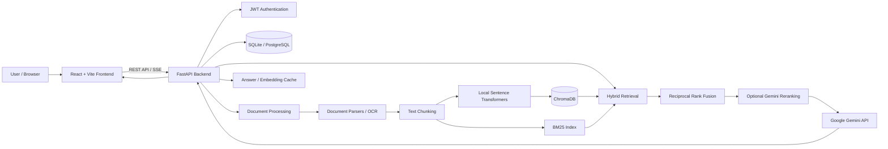

# DocuMind — Advanced RAG Q&A Chatbot with Hybrid Search

DocuMind is a full-stack AI-powered document intelligence platform built with FastAPI, React, ChromaDB, Google Gemini, and Sentence Transformers. It allows users to upload documents, ask natural-language questions, and receive grounded answers with passage-level citations, retrieval traces, and source verification.

The platform combines semantic vector search, BM25 keyword retrieval, Reciprocal Rank Fusion (RRF), and optional LLM reranking to improve document retrieval and answer relevance.

## Live Demo

- **Frontend:** [https://documind-cam8.onrender.com](https://documind-cam8.onrender.com)
- **Backend API:** [https://documind-api-2il5.onrender.com](https://documind-api-2il5.onrender.com)

> **Important — activate the backend first:** The backend is hosted on Render and may sleep after inactivity. Open the Backend API first and wait for it to respond. Then open the frontend and use the application. The first request may take a little while while the backend wakes up. Authentication, document uploads, and chat functionality require both services to be available.

## ✨ Overview

DocuMind is designed to make information retrieval from large collections of documents more accessible through conversational question answering.

Instead of manually searching through files, users can upload documents and interact with their contents through a conversational interface. The system processes the uploaded files, extracts and chunks their contents, generates local embeddings, and indexes the resulting chunks for retrieval.

When a user asks a question, DocuMind retrieves relevant passages using configurable retrieval strategies and sends the selected context to Google Gemini to generate a grounded response.

Every answer includes supporting citations and retrieval information, helping users understand where the answer came from and how the system selected its context.

The project demonstrates practical implementation of Retrieval-Augmented Generation (RAG), hybrid information retrieval, LLM integration, asynchronous processing, caching, evaluation, and full-stack application development.

## ✨ Features

### Document ingestion and management

- Upload PDF, DOCX, TXT, Markdown, XLSX, PPTX, HTML, and image files (PNG, JPG, WEBP).
- Drag-and-drop interface with support for multiple file uploads.
- Live ingestion stages and processing progress.
- Document parsing, text extraction, chunking, and embedding generation.
- Readable failure reasons for empty, corrupt, unsupported, oversized, or scanned documents without extractable text.
- Reindex and delete uploaded documents.
- Preserve page, slide, sheet, and section labels for citation metadata where supported.

### Advanced RAG and hybrid retrieval

- Semantic vector retrieval using ChromaDB.
- BM25 keyword retrieval using `rank_bm25`.
- Reciprocal Rank Fusion (RRF) to combine vector and keyword rankings.
- Three selectable retrieval modes:
  - `vector`
  - `hybrid`
  - `hybrid_rerank`
- Optional LLM-based reranking of retrieved passages.
- Configurable retrieval thresholds and top-K context selection.
- Follow-up question rewriting into standalone questions before retrieval.

### Grounded answers and citations

- Google Gemini-powered question answering.
- Streaming responses through Server-Sent Events (SSE).
- Passage-level citations linked to their supporting document content.
- Citation markers such as `[1]` open the matching passage with the supporting sentence highlighted.
- Retrieval context is used to ground generated answers.
- No-answer fallback using a score threshold and model-side `NOT_FOUND` check.
- The system can return a clear "not found" response when the documents do not contain sufficient information.

### Retrieval tracing and observability

- Retrieval funnel showing how many passages are retrieved, fused, reranked, and used.
- Example: `retrieved 20 -> fused 10 -> reranked 5 -> used 3`.
- Cache hit and miss indicators.
- Per-stage retrieval latency.
- Measured retrieval values rather than decorative or hardcoded metrics.
- Statistics and evaluation results available through application endpoints.

### Chat history and productivity

- Create and manage multiple chat sessions.
- Rename and delete conversations.
- View previous messages and their citations.
- Context-aware follow-up questions.
- Search conversation titles and message contents.
- Keyboard shortcut: `Ctrl/Cmd + K` to search chats.
- Upload new documents or select existing indexed documents through the chat composer.
- Export conversations as Markdown.
- Helpful/not-helpful feedback on assistant messages.

### Authentication, isolation, and caching

- JWT-based user authentication.
- User-specific document and conversation management.
- Database, vector, and BM25 queries filtered by user.
- Answer caching with configurable TTL.
- Embedding caching to reduce repeated computation.
- Per-user `index_version` invalidation to prevent stale cached answers.
- Cache hits avoid unnecessary model calls.

### Evaluation and quality

- Evaluation harness containing 37 questions across four sample documents.
- Comparison of vector, hybrid, and hybrid-rerank retrieval modes.
- Retrieval metrics including Hit@k and MRR.
- Answer accuracy, citation correctness, and fallback accuracy.
- Cold and warm cache latency measurements.
- 92 offline tests.
- Ruff-clean backend.
- GitHub Actions CI.
- Docker Compose deployment configuration.

## 💻 Tech Stack

| Layer / Category | Technologies | Purpose |
|---|---|---|
| Frontend | React 18, Vite, JavaScript | Build the interactive document and chat interface. |
| Styling | CSS, IBM Plex | Create the application layout and user interface. |
| Backend | Python 3.11, FastAPI | Handle application logic, document processing, and API requests. |
| API Server | Uvicorn | Run and serve the FastAPI application. |
| LLM Integration | Google Gemini Developer API | Generate grounded answers and support optional LLM reranking. |
| Embeddings | Sentence Transformers, all-MiniLM-L6-v2 | Generate local semantic embeddings without a paid embedding API. |
| Vector Database | ChromaDB | Store and retrieve document embeddings using cosine similarity. |
| Keyword Search | rank_bm25 | Retrieve documents using lexical keyword matching. |
| Retrieval Fusion | Reciprocal Rank Fusion (RRF) | Combine semantic and keyword retrieval rankings. |
| Database | SQLite, PostgreSQL | Store relational application data. |
| ORM | SQLAlchemy 2 | Manage database models and database operations. |
| Authentication | PyJWT, bcrypt | Handle JWT authentication and password hashing. |
| Document Parsing | pypdf, python-docx | Extract document content and metadata. |
| Background Jobs | Redis, RQ | Support durable document-ingestion jobs in Docker Compose. |
| OCR | Tesseract, PDFium | Process images and scanned PDF documents. |
| Testing | pytest, pytest-asyncio, httpx | Validate backend functionality and application behavior. |
| Code Quality | Ruff | Maintain Python code quality and linting. |
| Containerization | Docker, Docker Compose, Nginx | Support containerized deployment and service configuration. |
| CI/CD | GitHub Actions | Automate project validation and testing. |
| Deployment | Render | Host the frontend and backend services. |
| Database Hosting | Neon PostgreSQL | Provide managed PostgreSQL hosting when configured through `DATABASE_URL`. |

## 🧠 Working Algorithm

### 1. Document upload and ingestion

1. A user registers or logs into DocuMind.
2. The user uploads one or multiple supported documents through the React frontend.
3. The frontend sends the files to the FastAPI backend through a multipart API request.
4. The backend validates the uploaded files, including their format and size.
5. The document-processing pipeline extracts text and relevant location metadata.
6. Extracted content is divided into smaller chunks using configurable chunk size and overlap.
7. Sentence Transformers generates embeddings locally for the document chunks.
8. The chunks, embeddings, and associated metadata are indexed in ChromaDB.
9. BM25 indexing makes the document content available for keyword retrieval.
10. The document status and ingestion progress are made available to the frontend.

### 2. Hybrid document retrieval

1. A user submits a question through the chat interface.
2. The frontend sends the question and conversation context to the FastAPI backend.
3. The backend rewrites follow-up questions into standalone questions when necessary.
4. The question is converted into an embedding using the local Sentence Transformer model.
5. ChromaDB performs semantic vector retrieval to identify relevant document chunks.
6. BM25 performs keyword retrieval to identify passages matching important terms.
7. Reciprocal Rank Fusion combines the two ranked result lists.
8. If `hybrid_rerank` is selected, the Gemini model optionally reranks the fused candidate passages.
9. The system selects the most relevant context according to the configured retrieval settings.

### 3. Gemini-powered answer generation

1. The backend checks whether a valid cached answer exists.
2. If a cache hit occurs, the cached response is returned without another model call.
3. Otherwise, the selected document passages and user question are passed to the Gemini model.
4. Gemini generates an answer grounded in the retrieved document context.
5. The model-side `NOT_FOUND` check and retrieval score threshold help prevent unsupported answers.
6. The backend streams the response through Server-Sent Events.
7. Citation information is associated with the supporting document passages.
8. The completed answer and relevant metadata are cached according to the configured cache policy.
9. The frontend displays the response, citations, and retrieval trace.

### 4. Citation and retrieval trace

1. The backend identifies the document passages used to construct the answer.
2. Citation markers are associated with the corresponding source passages.
3. The frontend displays citation markers alongside the generated answer.
4. Selecting a citation opens the matching passage.
5. The supporting sentence is highlighted for easier verification.
6. The retrieval trace displays the number of passages retrieved, fused, reranked, and used.
7. Cache status and per-stage latency are displayed alongside the answer.

### 5. Chat history and user isolation

1. Each authenticated user can create and manage chat sessions.
2. The backend associates conversations and documents with the authenticated user.
3. Database queries and retrieval operations apply user-specific filtering.
4. Previous messages and citation information can be retrieved for a selected session.
5. Follow-up questions use the relevant conversation context.
6. Document index changes update the user's `index_version`.
7. Cached answers associated with older document indexes become invalidated.

## 🏗️ Architecture



The architecture combines local document embeddings and vector storage with Gemini-powered answer generation. Relational database storage is configurable through `DATABASE_URL`. Local file storage and Chroma persistence remain separate from the relational database.

Sequence diagrams for ingestion, asking, and cache invalidation are available in [`docs/architecture.md`](docs/architecture.md). Exact API request and response formats are documented in [`docs/CONTRACT.md`](docs/CONTRACT.md).

## 📂 Project Structure

```text
DocuMind/
│
├── backend/
│   ├── app/
│   ├── tests/
│   └── requirements.txt
│
├── frontend/
│   ├── src/
│   ├── package.json
│   └── package-lock.json
│
├── docs/
│   ├── architecture.md
│   └── CONTRACT.md
│
├── eval/
│   ├── run_eval.py
│   └── results/
│
├── .env.example
├── docker-compose.yml
├── Makefile
├── README.md
└── .gitignore
```

## ⚙️ Run Locally

### Prerequisites

- Python 3.11+
- Node.js and npm
- Git
- Google AI Studio API key for real Gemini responses
- Docker and Docker Compose (optional)

### 1. Clone the repository

```bash
git clone https://github.com/uzaam07/DocuMind-RAG-QA-Chatbot.git
cd DocuMind-RAG-QA-Chatbot
```

### 2. Configure environment variables

Create a repository-root `.env` file using the example configuration:

```bash
cp .env.example .env
```

Add your Gemini API key:

```env
GEMINI_API_KEY=your_gemini_api_key
MOCK_LLM=false
```

Keep your API key private. Never commit `.env` or production secrets to GitHub.

### 3. Set up the backend

Create and activate a Python virtual environment:

```bash
python -m venv .venv
```

Windows PowerShell:

```powershell
.\.venv\Scripts\Activate.ps1
```

Install backend dependencies:

```bash
pip install -r backend/requirements-dev.txt
```

Start the backend:

```bash
cd backend
uvicorn app.main:app --reload
```

Backend:

```text
http://127.0.0.1:8000
```

Swagger API documentation:

```text
http://127.0.0.1:8000/docs
```

### 4. Set up the frontend

Open a separate terminal:

```bash
cd frontend
npm install
```

Create a frontend `.env` file:

```env
VITE_API_BASE_URL=http://127.0.0.1:8000
```

Start the frontend:

```bash
npm run dev
```

Frontend:

```text
http://localhost:5173
```

### 5. Run using Docker

Alternatively, configure `.env` and start the application using Docker Compose:

```bash
docker compose up --build
```

- Application: `http://localhost:3000`
- Backend Swagger UI: `http://localhost:8000/docs`

Create an account, choose **Load sample documents**, and ask:

```text
What are the core hours at Meridian Labs?
```

For local development without a real model, use `MOCK_LLM=true`. To use Gemini, configure `GEMINI_API_KEY` and set `MOCK_LLM=false`.

Embeddings run locally through Sentence Transformers and do not call a paid embedding API.

## 🔧 Configuration

All settings are configurable through environment variables. Refer to [`.env.example`](.env.example).

| Variable | Default | Purpose |
|---|---|---|
| `GEMINI_API_KEY` | None | Google AI Studio key; required unless `MOCK_LLM=true`. |
| `MOCK_LLM` | `false` | Enables deterministic offline models for tests, CI, and demos. |
| `JWT_SECRET` | Placeholder | Set a long, secure random value before deployment. |
| `JWT_EXPIRE_MINUTES` | `60` | JWT token lifetime. |
| `BCRYPT_ROUNDS` | `12` | Password hashing cost. |
| `GEMINI_CHAT_MODEL` | `gemini-3.5-flash-lite` | Gemini chat and reranking model. Availability and free-tier quotas depend on the Google account and project. |
| `LOCAL_EMBEDDING_MODEL` | `sentence-transformers/all-MiniLM-L6-v2` | Local embedding model. Re-index documents after changing the model. |
| `CHUNK_SIZE` / `CHUNK_OVERLAP` | `800` / `150` | Characters per document chunk and overlap. |
| `TOP_K` | `5` | Number of chunks passed to the model. |
| `RETRIEVAL_MODE` | `hybrid_rerank` | Default retrieval mode when a request does not select one. |
| `SCORE_THRESHOLD` | `0.25` real, `0.12` mock | Minimum cosine similarity for `vector` and `hybrid`. |
| `RERANK_THRESHOLD` | `0.3` | Minimum rerank score (0–1) for `hybrid_rerank`. |
| `MAX_UPLOAD_MB` | `20` | Per-file upload size limit. |
| `CACHE_TTL_SECONDS` | `86400` | Answer cache lifetime. |
| `CORS_ORIGINS` | Localhost development origins | Comma-separated permitted frontend origins. |
| `DATA_DIR` | `./data` from `backend/` | Local database, Chroma, and uploaded-file storage. |
| `EVAL_RESULTS_PATH` / `SAMPLE_DOCS_DIR` | Evaluation defaults | Evaluation output and bundled sample-document paths. |
| `DATABASE_URL` | SQLite by default | Optional SQLAlchemy database connection, including PostgreSQL. |

## 🔌 API Overview

Full request and response formats are documented in [`docs/CONTRACT.md`](docs/CONTRACT.md). Interactive API documentation is available through Swagger at `/docs`.

| Method | Endpoint | Purpose |
|---|---|---|
| GET | `/health` | Liveness, database, and Chroma checks. |
| POST | `/api/auth/register` | Register a user. |
| POST | `/api/auth/login` | Authenticate and obtain a JWT. |
| GET | `/api/auth/me` | Retrieve the current user. |
| POST / GET | `/api/documents` | Upload documents / list documents. |
| GET / DELETE | `/api/documents/{id}` | Retrieve document details / delete a document and associated data. |
| POST | `/api/documents/{id}/reindex` | Re-run document ingestion. |
| POST | `/api/documents/sample` | Load bundled sample documents (idempotent). |
| GET / POST | `/api/sessions` | List / create chat sessions. |
| PATCH / DELETE | `/api/sessions/{id}` | Rename / delete chat sessions. |
| GET | `/api/sessions/{id}/messages` | Retrieve chat history with citations and retrieval traces. |
| POST | `/api/sessions/{id}/ask` | Ask a question with SSE streaming. |
| POST | `/api/ask` | Ask without a session and receive one JSON response. |
| GET | `/api/stats` | Retrieve cache hit rates and usage statistics. |
| GET | `/api/eval/latest` | Retrieve the latest evaluation results. |

Streaming responses use SSE events including `stage`, `citations`, `token`, `done`, and `error`.

API errors use a consistent structure:

```json
{
  "error": {
    "code": "...",
    "message": "..."
  }
}
```

## 🧪 Backend Testing

DocuMind includes an offline backend test suite covering core application functionality.

Run the complete test workflow:

```bash
make test
```

Run backend tests directly:

```bash
cd backend
python -m pytest -q
```

The project includes **92 offline tests** with `MOCK_LLM=true`, covering:

- Authentication and user isolation.
- Document parsing and intake validation.
- Text chunking and retrieval.
- Reciprocal Rank Fusion calculations.
- Reranking JSON handling.
- RAG fallback and follow-up question rewriting.
- Cache hit, miss, TTL, and invalidation.
- Zero model calls on an answer-cache hit.
- Cross-user data isolation.
- SSE event order and payloads.
- API error envelopes.
- Restart recovery.
- Evaluation harness functionality.

The backend is Ruff-clean and includes GitHub Actions CI.

## 📊 Evaluation

DocuMind includes an evaluation harness to compare retrieval strategies and measure RAG pipeline behaviour.

Run deterministic mock evaluation:

```bash
python eval/run_eval.py --mock
```

Run evaluation using the Gemini API:

```bash
python eval/run_eval.py
```

The real-model evaluation requires `GEMINI_API_KEY` and consumes Gemini API quota.

### Evaluation dataset

The evaluation harness indexes four original sample documents (Markdown, PDF, DOCX, and plain text) into a temporary store.

It runs **37 questions per retrieval mode**:

| Question Category | Count |
|---|---:|
| Single-fact questions | 14 |
| Paraphrased questions | 8 |
| Multi-hop questions | 6 |
| Unanswerable questions | 9 |
| **Total** | **37** |

The evaluation reports:

- Hit@k and Mean Reciprocal Rank (MRR).
- LLM-judged answer accuracy.
- Citation correctness.
- Fallback accuracy.
- p50 and p95 latency.
- Cold-cache versus warm-cache latency.

Results are written to `eval/results/report.md` and `results.json`, which are also displayed through the in-app Stats page.

### Results: Mock models

> These results come from deterministic mock models, not real Gemini inference. Mock embeddings match words rather than meaning, so paraphrased questions mostly fail by design. These results demonstrate that the evaluation pipeline and metrics work; they are not a real-model quality claim. Mock latency measures local code only.

| Retrieval Mode | Hit@5 | MRR | Answer Accuracy | Citation Correctness | Fallback Accuracy | p50 (ms) | p95 (ms) |
|---|---:|---:|---:|---:|---:|---:|---:|
| `vector` | 78.6% | 0.667 | 53.6% | 60.7% | 67.6% | 13 | 15 |
| `hybrid` | 82.1% | 0.717 | 53.6% | 60.7% | 67.6% | 14 | 18 |
| `hybrid_rerank` | 89.3% | 0.795 | 55.4% | 64.3% | 70.3% | 13 | 15 |

**Answer cache performance:** Cold cache: 14 ms vs. warm cache: 7 ms — a measured **2.0× improvement** across 10 repeated questions.

### Results: Real Gemini models

Real-model evaluation has not yet been run. Execute `python eval/run_eval.py` with a valid Gemini API key and use the generated report to record real-model results.

## 🧩 Design Decisions and Trade-offs

- **Hybrid search with RRF:** Embeddings help identify paraphrases, while BM25 captures exact terms such as error codes and names. RRF combines rankings without requiring score-scale calibration, using the conventional `k=60`.
- **LLM reranking:** The fused top 10 candidates can be reranked in one batched model call. Malformed model output falls back to the fused ranking instead of failing the request.
- **Index-version cache invalidation:** A per-user `index_version` is included in cache keys. When the user's document index changes, old cached answers become unreachable and are purged.
- **Citation and streaming order:** Citations are sent before answer tokens. The server checks the initial streamed tokens for the `NOT_FOUND` sentinel so unsupported answers do not display citations.
- **Location-aware chunks:** Chunks do not cross page or section boundaries. Labels such as `Page 4` or `Section: Leave Policy` remain precise for citation metadata and evaluation.
- **Retrieval score transparency:** Cosine similarity is shown for `vector` and `hybrid`; the rerank score is shown for `hybrid_rerank`. Thresholds are configurable for their respective score scales.
- **Context-aware caching:** Follow-up context is included in the answer cache key. The same question in a conversation with earlier turns can therefore produce a cache miss, while a fresh conversation can reuse an existing result.

## 🌐 Deployment

DocuMind is deployed using Render, with the frontend and backend hosted as separate services.

| Component | Deployment |
|---|---|
| Frontend | Render Static Site |
| Backend | Render Web Service |
| Relational Database | SQLite locally; PostgreSQL configurable through `DATABASE_URL` |
| AI Model | Google Gemini Developer API |
| Vector Database | ChromaDB |
| Embeddings | Local Sentence Transformers |

### Production environment variables

Configure the required environment variables in the hosting provider.

Backend:

```env
GEMINI_API_KEY=your_gemini_api_key
GEMINI_CHAT_MODEL=gemini-3.5-flash-lite
MOCK_LLM=false
JWT_SECRET=your_secure_random_secret
DATABASE_URL=your_database_connection_string
CORS_ORIGINS=https://your-frontend-domain
DATA_DIR=./data
RETRIEVAL_MODE=hybrid
MAX_UPLOAD_MB=20
```

Frontend:

```env
VITE_API_BASE_URL=https://your-backend-domain
```

Never commit production secrets, `.env` files, virtual environments, local databases, uploaded documents, or generated build directories to GitHub.

**Storage note:** PostgreSQL configuration through `DATABASE_URL` changes the relational database backend; it does not automatically move uploaded documents or ChromaDB vector files into Neon. The current implementation uses local file storage and local Chroma persistence by default. Render's ephemeral filesystem can lose these files when the service restarts or redeploys. Durable object storage and shared vector storage require additional integration.

## ⚠️ Known Limitations

- Docker images were not built in the original authoring environment because a Docker daemon was unavailable. The Compose file was syntax-checked as YAML, but a complete container startup should be validated separately.
- Real-model quality and latency have not been measured through the evaluation harness yet.
- Mock embeddings are lexical rather than semantic, so paraphrased questions can fail in mock mode.
- OCR requires the Tesseract runtime. Docker installs the English Tesseract executable; local development must install Tesseract separately.
- Scanned PDF rendering uses PDFium through `pypdfium2`.
- Redis/RQ provides durable ingestion jobs in Docker Compose. Local development without `REDIS_URL` uses FastAPI background tasks as a convenience fallback.
- SQLite and local file/Chroma storage remain the defaults. PostgreSQL is configurable with `DATABASE_URL`, but S3-compatible object storage and multi-instance Chroma are not implemented.
- BM25 indexes and cache counters are process-local. Multi-instance deployments need a shared lexical index and distributed metrics/cache strategy.
- Rate limiting, email verification, password reset, refresh-token rotation, per-user quotas, and audit logs are not implemented in this build.
- Conversation editing/regeneration, document comparison/extraction workflows, and a full source-document preview are not implemented in this build.
- Rejected uploads are not stored, so Retry requires uploading the original file again.
- Browser coverage beyond Chromium-based browsers has not been verified.

## 🔭 Future Work

- S3-compatible object storage and a shared vector/lexical retrieval service for horizontal scaling.
- Password recovery, email verification, refresh-token rotation, quotas, rate limits, and audit logs.
- Conversation editing/regeneration and document comparison, extraction, and preview workflows.
- Streaming citation highlighting from model-reported spans instead of sentence overlap.
- Larger, domain-specific evaluation datasets and a regression gate in CI based on real-model scores.

## 🎯 Project Goals

DocuMind demonstrates practical experience in:

- Retrieval-Augmented Generation (RAG) system design.
- Hybrid information retrieval using semantic and lexical search.
- Vector databases and embedding-based document search.
- LLM integration and grounded question answering.
- Passage-level citations and retrieval observability.
- Full-stack application development using React and FastAPI.
- REST API design and Server-Sent Events.
- JWT authentication and multi-user data isolation.
- Database management, caching, and background processing.
- Automated testing, evaluation, and CI/CD.
- Containerization and cloud deployment.


## 👨‍💻 Author

**Uzaam Shaad K**

- GitHub: [@uzaam07](https://github.com/uzaam07)
- LinkedIn: [linkedin.com/in/uzaamshaad](https://www.linkedin.com/in/uzaamshaad)

---

⭐ If you find DocuMind interesting, consider giving the repository a star!
