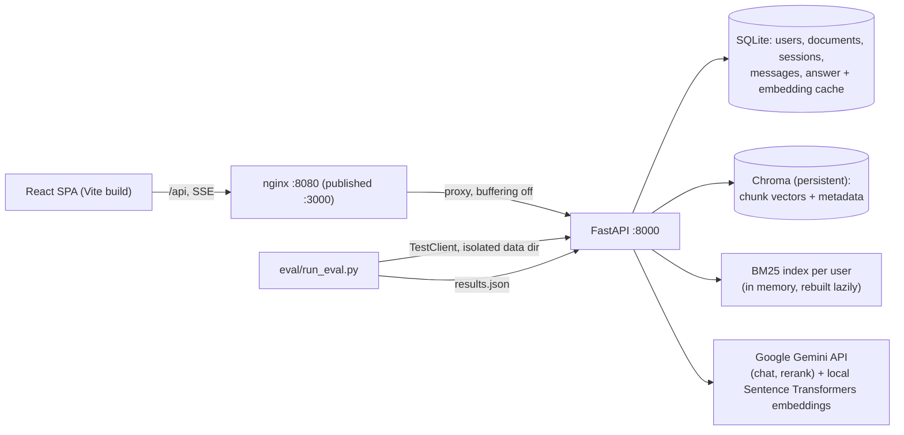
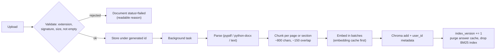
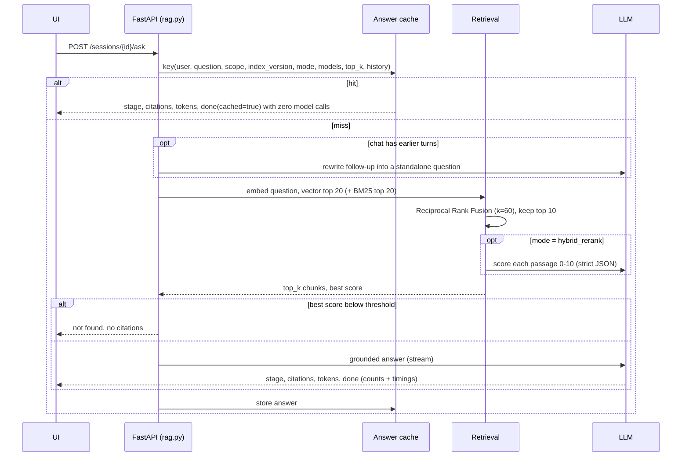

# Architecture

## Components

## Ingestion

Document rows carry `stage`, `progress_done` and `progress_total`, so the UI shows "Embedding 34/120".
Documents left in `processing` by a crash are marked failed on the next start and can be reindexed.

## Asking a question

The first decoded tokens are inspected before `citations` is sent: if the model replies with the `NOT_FOUND`
sentinel, the stream ends as a not-found answer with an empty citations list.

## Retrieval modes

| Mode | Candidate generation | Ordering | Score shown and thresholded |
|---|---|---|---|
| `vector` | Chroma cosine, top 20 | similarity | cosine similarity |
| `hybrid` | vector top 20 + BM25 top 20 | RRF (k=60), top 10 | cosine similarity |
| `hybrid_rerank` | as hybrid | LLM relevance 0-10 on the fused top 10 | rerank score / 10 |

If the reranker returns malformed JSON the fused order is kept and cosine similarity is used instead.

## Cache keys and invalidation

- **Answer cache key**: SHA-256 of user id, normalised question, sorted document scope, the user's `index_version`,
  retrieval mode, chat model, embedding model, `TOP_K` and a digest of the recent chat turns. Entries expire after
  `CACHE_TTL_SECONDS`.
- **`index_version`** is a per-user counter bumped whenever a document finishes indexing or is deleted, so an answer
  produced from an older index is never served. Old rows are purged at the same time.
- **Embedding cache key**: SHA-256 of embedding model and text, stored as float32 bytes.
- Because follow-up context changes meaning, the same question inside a chat that already has turns is a different key
  from the same question in a fresh chat.

## Isolation

Every Chroma query filters on `user_id`, the BM25 index is built per user, every SQL query filters on the
authenticated user, and cache keys include the user id. Document ids supplied by a client are intersected with the
user's own ready documents.

## Data model (SQLite)

`users` (index_version), `documents` (status, stage, progress, storage path), `chat_sessions`, `messages`
(citations and the full `done` payload as JSON), `answer_cache`, `embedding_cache`.

## Updated ingestion and conversation services

The document parser now normalizes PDF, DOCX, TXT, Markdown, XLSX, PPTX, HTML and image inputs into location-labelled text blocks. XLSX worksheets and PPTX slides retain source labels. HTML parsing removes active and navigation content. Image and scanned-PDF OCR use Tesseract, with PDFium used to render scanned PDF pages. OCR depends on the Tesseract executable being installed in the runtime.

In Docker Compose, upload and reindex operations enqueue work in Redis/RQ and a separate worker runs the existing idempotent ingestion service. Local development without `REDIS_URL` retains FastAPI background tasks. SQLAlchemy can use SQLite by default or a PostgreSQL URL supplied through `DATABASE_URL`; file storage and Chroma remain local-volume based in this release.

Conversation search is an owner-filtered SQL query over session titles and message contents. The frontend opens it through a command palette (`Ctrl/Cmd + K`). Composer attachments reuse the same document upload and scope mechanisms as the Documents page. Markdown export and per-message feedback are also exposed through authenticated routes.
